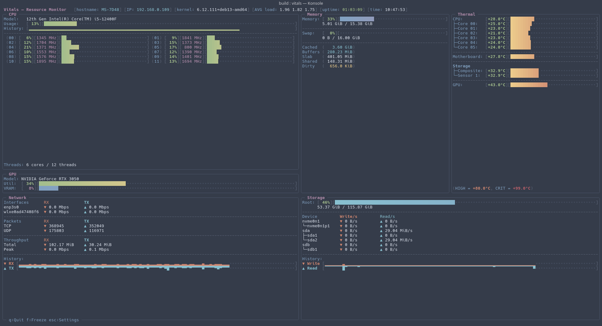
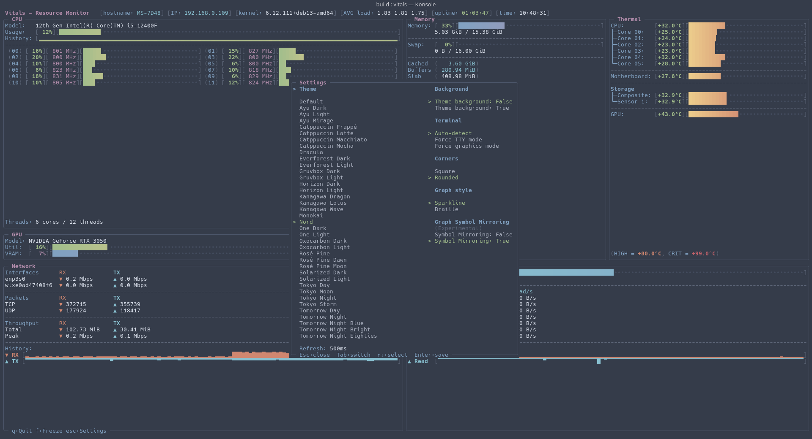

<h1 align="center">Vitals</h1>
<h3 align="center">A terminal resource monitor for Linux built with notcurses.</h3>

<div align="center">

[](https://www.gnu.org/software/bash/)
[](https://en.cppreference.com/w/cpp/20)
[](LICENSE)
[](https://kernel.org)
[](https://cmake.org/)
[](https://github.com/dankamongmen/notcurses)

### Supported Distros

[](https://www.debian.org)
[](https://ubuntu.com)
[](https://fedoraproject.org)
[](https://almalinux.org)
[](https://www.opensuse.org)
[](https://archlinux.org)

### Build Status

[](https://github.com/rebootless/vitals/actions/workflows/build.yml)
[](https://github.com/rebootless/vitals/actions/workflows/build.yml)
[](https://github.com/rebootless/vitals/actions/workflows/build.yml)
[](https://github.com/rebootless/vitals/actions/workflows/build.yml)
[](https://github.com/rebootless/vitals/actions/workflows/build.yml)
[](https://github.com/rebootless/vitals/actions/workflows/build.yml)
[](https://github.com/rebootless/vitals/actions/workflows/build.yml)
[](https://github.com/rebootless/vitals/actions/workflows/build.yml)
[](https://github.com/rebootless/vitals/actions/workflows/build.yml)
[](https://github.com/rebootless/vitals/actions/workflows/build.yml)
[](https://github.com/rebootless/vitals/actions/workflows/build.yml)
[](https://github.com/rebootless/vitals/actions/workflows/build.yml)
[](https://github.com/rebootless/vitals/actions/workflows/build.yml)

</div>

<p align="center">
  
</p>

<p align="center">
  
</p>

## ⚡ Installation

### Quick Install

Install the latest version with a single command:

```bash
bash <(curl -fsSL https://raw.githubusercontent.com/rebootless/vitals/main/install.sh)
```

The installer automatically:

- Installs the required build dependencies
- Clones the Notcurses source at the release pinned by `NOTCURSES_VERSION` in `setup.sh`
- Builds Vitals
- Installs Vitals and its bundled themes under `/usr/local`

Safe to run multiple times.

### Quick Uninstall

Remove Vitals and its bundled themes with a single command:

```bash
bash <(curl -fsSL https://raw.githubusercontent.com/rebootless/vitals/main/uninstall.sh)
```

The uninstaller:

- Removes the Vitals binary from `/usr/local/bin`
- Removes the bundled themes from `/usr/local/share/vitals/themes`
- Removes `/usr/local/share/vitals` if it is empty
- Asks before deleting your saved configuration and themes at `~/.config/vitals` (or `$XDG_CONFIG_HOME/vitals` when configured)

<details>
<summary align="center"><b>Build from Source</b> <i>(click to expand)</i></summary>

Clone the repository:

```bash
git clone https://github.com/rebootless/vitals.git
cd vitals
```

Prepare the build environment:

```bash
chmod +x setup.sh
./setup.sh
```

Build:

```bash
chmod +x build.sh
./build.sh
```

Install:

```bash
sudo cmake --install build
```

</details>

<details>
<summary align="center"><b>Run Without Installing</b> <i>(click to expand)</i></summary>

```bash
git clone https://github.com/rebootless/vitals.git
cd vitals

chmod +x setup.sh build.sh
./setup.sh
./build.sh

./build/vitals
```

</details>

> [!NOTE]
> Symbol Mirroring is experimental and may render incorrectly depending on your environment.
> Mirrored glyphs require font and Unicode 13+ `wcwidth` support.
> Terminal emulators may handle these glyphs differently.
> The Linux TTY (`TERM=linux`) does not support them.

## 📊 Panels

| Panel | Data source | Metrics |
| ---- | ---- | ---- |
| **CPU** | `/proc/stat`, `/sys/devices/system/cpu/cpu*/cpufreq/` | CPU usage, per-core activity, frequency, history |
| **GPU** | `/sys/class/drm`, `/sys/class/hwmon`, `nvidia-smi` | GPU utilization, VRAM, temperature, power |
| **Memory** | `/proc/meminfo` | RAM and swap usage |
| **Network** | `/proc/net/dev` | Per-interface RX/TX throughput |
| **Storage** | `/proc/diskstats`, `statvfs()` | Filesystem usage and disk I/O |
| **Thermal** | `/sys/class/thermal`, `/sys/class/hwmon` | CPU, GPU, and motherboard temperatures |

> [!NOTE]
> The GPU panel is displayed only when a supported device is detected. Otherwise, the CPU panel expands to use the available space.

## ⌨️ Controls

| Key | Action |
| :--- | :--- |
| `q` | Quit |
| `f` | Freeze |
| `Esc` | Open the settings menu |
| `Tab` | Select the next option |
| `↑` / `↓` | Change the selected value |
| `Enter` | Save changes and close |
| `Esc` *(in settings)* | Discard changes and close |

## 🧩 Self-test

```bash
vitals --self-test
```

Checks that every data source Vitals reads (CPU, memory, GPU, storage, network, thermal sensors, and system info) is available and returns sane values.

> [!NOTE]
> Linux buffers disk writes in RAM, then flushes them in batches.
> So downloads may show steady Network traffic while Storage stays idle.

## ♻️ Clean Up Legacy Installations

Remove files left by older pre-release versions:

```bash
sudo rm -f /usr/local/bin/vitals

for d in /usr/local/lib /usr/local/lib64; do
    sudo rm -f "$d"/libnotcurses*.so* "$d"/libnotcurses*.a
    sudo rm -rf "$d"/cmake/Notcurses*
    sudo rm -f "$d"/pkgconfig/notcurses*.pc
done

sudo rm -rf /usr/local/include/notcurses /usr/local/include/ncpp
sudo rm -f /etc/ld.so.conf.d/usr_local_lib.conf
sudo ldconfig
```

> [!CAUTION]
> This removes all matching Notcurses files from `/usr/local`, including installations used by other software. Run these commands only if you intend to remove those files.

## 📋 Requirements

- Linux (kernel ≥ 4.x)
- Bash 5.0+
- GCC or Clang with C++20 support
- CMake ≥ 3.21
- Internet access (required to download Notcurses during setup)

## 📄 License

<p align="center">
  Licensed under the <strong>GNU General Public License v3.0</strong>. See the <a href="LICENSE">LICENSE</a> file for details.
</p>
